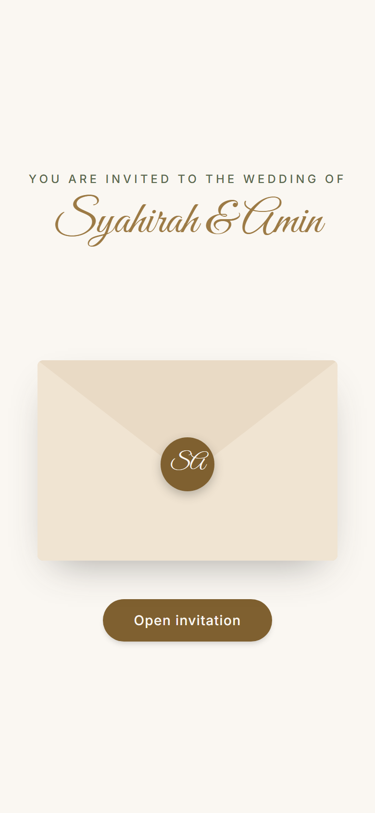
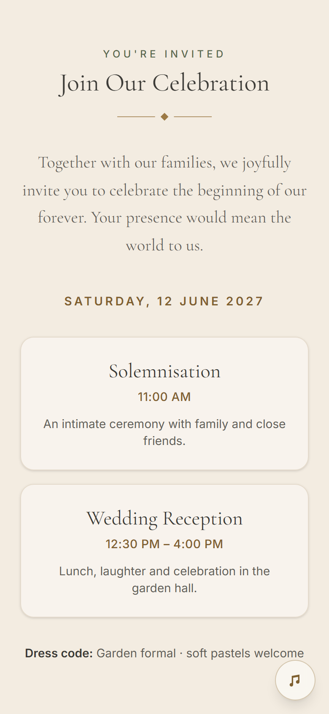
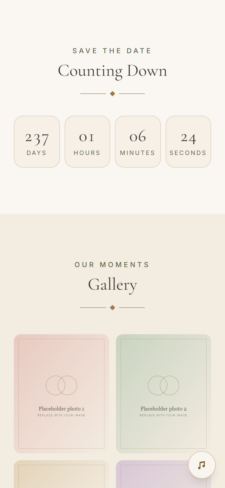
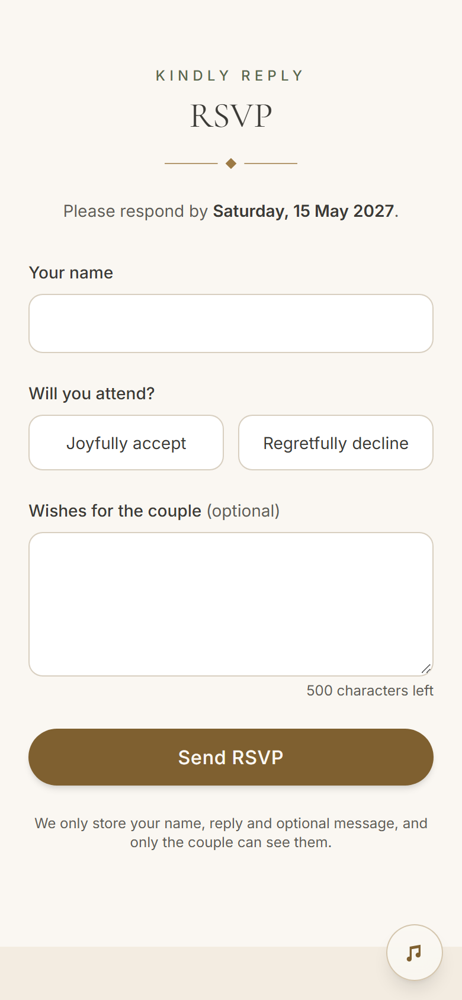
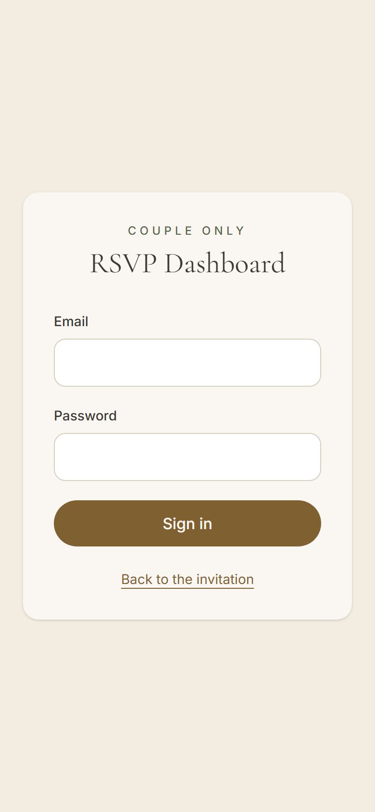
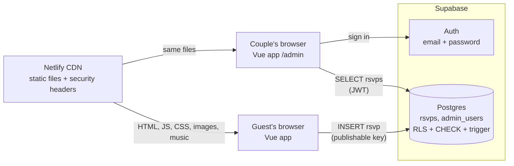

# Digital Wedding Invitation

A mobile-first digital wedding invitation with an animated envelope, live countdown,
photo gallery, background music, RSVP form and a private RSVP dashboard for the couple.

Built with **Vue 3**, **Supabase** and **Netlify**, with **no backend server of its own**:
the database enforces validation and access control through Row Level Security.

**Live demo:** https://ornate-crumble-cb085e.netlify.app

> Portfolio project. Photos are generated placeholders, and the venue and address are fictional.

| Envelope | Invitation | Details | Countdown | RSVP | Admin |
|---|---|---|---|---|---|
|  |  |  |  |  |  |

## Features

**For guests**
- Animated 3D envelope that opens into the invitation
- Couple names with a shimmering gold effect, wedding date and invitation message
- Event schedule and dress code
- Live countdown to the wedding (always in the venue's timezone)
- Responsive photo gallery with a full-screen viewer (← → keys to browse, Esc to close)
- Venue with **Google Maps** and **Waze** links
- Background music with explicit play/pause (never autoplays; shows a loading state on slow connections)
- RSVP form: name, attendance, guest count, optional wishes, with validation, loading, success and error states
- **Share on WhatsApp** button

**For the couple (admin)**
- Secure sign-in (Supabase Auth)
- Totals: expected guests, attending, declined, total responses
- Search by name or wishes, filter by reply

**Quality**
- WCAG AA colour contrast, keyboard and screen-reader support, reduced-motion support (axe-core: 0 violations)
- Strict Content Security Policy and security headers
- 92 automated tests, plus live security checks against the real database

## Tech stack

| Layer | Choice | Why |
|---|---|---|
| UI | Vue 3 (Composition API, `<script setup>`), JavaScript | Reactive UI with small, readable components |
| Build | Vite | Fast dev server; code splitting keeps guest downloads small |
| Styling | Tailwind CSS v4 | Design tokens (colours, fonts) defined once in CSS |
| Routing | Vue Router | `/`, `/admin/login`, `/admin` |
| Data and auth | Supabase (Postgres, Auth) | Database rules replace a custom backend |
| Hosting | Netlify | Static hosting, deploys on every push, security headers |
| Tests | Vitest, Vue Test Utils, jsdom | Unit and component tests |

## Architecture



The browser talks to Supabase directly using a **public** key. Security does not depend on hiding
anything in the browser: Postgres checks every request.

- Guests can **only insert** an RSVP, and only the four guest columns. They cannot read anyone's data.
- Only users listed in `admin_users` can read RSVPs. Nobody can update or delete through the API.
- The `/admin` route guard is for convenience; the database is the real gatekeeper.

More diagrams (request flows, data model, components) and design decisions: **[docs/ARCHITECTURE.md](docs/ARCHITECTURE.md)**.
Threat model, controls and trade-offs: **[docs/SECURITY.md](docs/SECURITY.md)**.

## Project structure

```
src/
  config/wedding.js        All invitation content (names, date, venue, events, gallery, music)
  views/                   Pages: InvitationView, AdminLoginView, AdminDashboardView, NotFoundView
  components/invitation/   Envelope, hero, details, countdown, gallery, venue, RSVP, music, share
  components/admin/        RsvpStats, RsvpTable
  components/ui/           SectionHeading, OrnamentDivider
  composables/             useCountdown, useAuth
  services/                rsvp.js (submit), admin.js (paged fetch)
  utils/                   Pure functions: dates, map links, validation, stats, share URL
  lib/supabase.js          The single Supabase client
  router/index.js          Routes and the admin guard
supabase/
  migrations/001_rsvp_schema.sql   Tables, constraints, grants, RLS, trigger
  tests/rate_limit_check.sql       Self-cleaning check of the rate limit
scripts/
  verify-rls.mjs           Live "attacker" checks against your Supabase project
  generate-placeholders.mjs  Generates placeholder photos and music
public/
  _headers                 Security headers (used by Netlify and `npm run preview`)
tests/unit/                Vitest tests
docs/                      Architecture, security review, case study, verification record
```

## Getting started

### Prerequisites
- Node.js **20.19+** or **22.12+**
- A free [Supabase](https://supabase.com) account

### 1. Install
```bash
git clone https://github.com/amemeee/wedding-card.git
cd wedding-card
npm ci
```

### 2. Set up Supabase
1. Create a project. Under **Security**, keep the **Data API on**, turn **"Automatically expose new tables" off**, and turn **automatic RLS on**. The migration grants access explicitly, so it doesn't rely on defaults.
2. **SQL Editor:** paste and run [`supabase/migrations/001_rsvp_schema.sql`](supabase/migrations/001_rsvp_schema.sql). The "destructive operations" warning is expected: the file only drops and recreates its own policies and trigger, so it is safe to re-run.
3. **Create the admin account:** Authentication → Users → **Add user**, then copy its UUID and run:
   ```sql
   insert into public.admin_users (user_id) values ('<your-user-uuid>');
   ```
4. **Turn off public sign-ups:** Authentication → Sign In / Providers → disable "Allow new users to sign up".

### 3. Configure environment variables
```bash
cp .env.example .env.local
```
Fill in the values from **Connect** (or Project Settings → API Keys) in Supabase:
```
VITE_SUPABASE_URL=https://<project-ref>.supabase.co
VITE_SUPABASE_PUBLISHABLE_KEY=sb_publishable_...
```
Use the **publishable** key only. It is designed to be public. **Never** put the secret or `service_role` key in this project.

### 4. Run
```bash
npm run dev        # http://localhost:5173
```
Open `/admin` to sign in as the admin.

> Opening `index.html` with VS Code's Live Server shows a blank page. Vite has to compile `.vue` files and package imports, so always use `npm run dev`.

## Scripts

| Command | What it does |
|---|---|
| `npm run dev` | Development server with instant reload |
| `npm test` | Run all unit and component tests once |
| `npm run test:watch` | Re-run tests on every save |
| `npm run build` | Production build into `dist/` |
| `npm run preview` | Serve `dist/` locally **with the production security headers** |
| `npm run verify:rls` | Attack your live Supabase project as an anonymous user; every attempt must be denied |
| `npm run verify:rls -- --insert` | Same, plus one clearly labelled test RSVP (delete it afterwards in the Table Editor) |
| `node scripts/generate-placeholders.mjs` | Regenerate placeholder photos and music |

## Testing and verification

- **Unit and component tests** (`npm test`): validation, error mapping, countdown maths and timer cleanup,
  envelope behaviour, gallery, music states, RSVP form states, admin guard, dashboard filtering,
  real `useAuth` logic, XSS escaping, and a guard that fails if the CSP is ever loosened.
  Tests never touch the real database: Supabase variables are blanked in test mode.
- **Live database checks:** `npm run verify:rls` (11 attacks denied plus a valid insert) and
  `supabase/tests/rate_limit_check.sql` (rolls itself back).
- **Real browser checks:** headless Chrome via the DevTools protocol, including axe-core accessibility audits,
  CSP violation tracking and throttled-network tests.

The full record of every check, including the ones that failed first, is in **[docs/VERIFICATION.md](docs/VERIFICATION.md)**.

## Deployment (Netlify)

1. Push the repo to GitHub.
2. Netlify → **Add new site → Import an existing project → GitHub** → select the repo.
   Build settings come from [`netlify.toml`](netlify.toml); leave them as they are.
3. Add environment variables `VITE_SUPABASE_URL` and `VITE_SUPABASE_PUBLISHABLE_KEY`.
   **Do not** mark them as "Contains secret values": they are meant to be in the browser bundle,
   and Netlify's secret scanning would fail the build.
4. Deploy. Then check **Site configuration → Access & security → Visitor access** is set to public.
   Otherwise every visitor gets a Netlify login page.
5. Optional: in Supabase → Authentication → URL Configuration, set **Site URL** to your Netlify URL.

Every push to `main` redeploys automatically. `VITE_*` variables are compiled in at build time,
so after changing one in Netlify, use **Deploys → Trigger deploy**.

## Customising the invitation

- **Content:** edit [`src/config/wedding.js`](src/config/wedding.js). Names, date (ISO 8601 with offset), timezone,
  message, events, dress code, venue, RSVP deadline, gallery and music all live there.
- **Names are optional.** Leave `partnerOne` / `partnerTwo` empty to show `title` (e.g. "Our Wedding") everywhere instead.
  Set `monogram` (e.g. `'AH'`) for the envelope seal, or leave it empty for a rings emblem.
- **Photos:** put images in `public/gallery/` and list them in `gallery` with `width`, `height` and descriptive `alt` text.
- **Music:** put the file in `public/audio/` and set `music.src`. Prefer **MP3 at about 128 kbps**:
  uncompressed WAV is about 10× larger, uses guests' mobile data and can stutter on slow connections.
  Only publish music you have the rights to; the repo and site are public.
- **Colours and fonts:** design tokens are at the top of [`src/style.css`](src/style.css). Contrast values were
  checked with axe-core; re-run an audit if you change them.
- **Validation limits:** change them in **both** [`src/utils/rsvpValidation.js`](src/utils/rsvpValidation.js) (UX)
  and the `CHECK` constraints in the migration (enforcement).

## Known limitations

- **Rate limiting is global** (20 RSVPs per minute across all guests). Postgres can't see client IP addresses
  through the Data API, so per-IP limits or CAPTCHA would need a server-side function.
- **One wedding per deployment.** Content lives in a config file, not the database.
- **The admin session token is stored in `localStorage`.** This is mitigated by a strict CSP and escaped output;
  a server-rendered app could use HttpOnly cookies instead.
- **WhatsApp link previews** use the static tags in `index.html`, not per-guest or per-wedding previews.

## Roadmap

**v2: multi-couple platform.** Couples sign up, create and edit their own wedding at `/w/:slug`,
choose a **template**, upload photos and music, and see only their own RSVPs. This means
ownership-based RLS instead of a single admin list, Supabase Storage, sign-up with CAPTCHA,
and a first server-side function for per-wedding link previews.

## Documentation

- [docs/ARCHITECTURE.md](docs/ARCHITECTURE.md): diagrams and key design decisions
- [docs/SECURITY.md](docs/SECURITY.md): threat model, controls, verification, trade-offs
- [docs/CASE_STUDY.md](docs/CASE_STUDY.md): portfolio case study
- [docs/VERIFICATION.md](docs/VERIFICATION.md): record of every check, including failures

## License

© 2026 amemeee. **All rights reserved.** This code is shared for viewing as a portfolio piece only.
You may not copy, modify, or reuse it without written permission. See [LICENSE](LICENSE).
