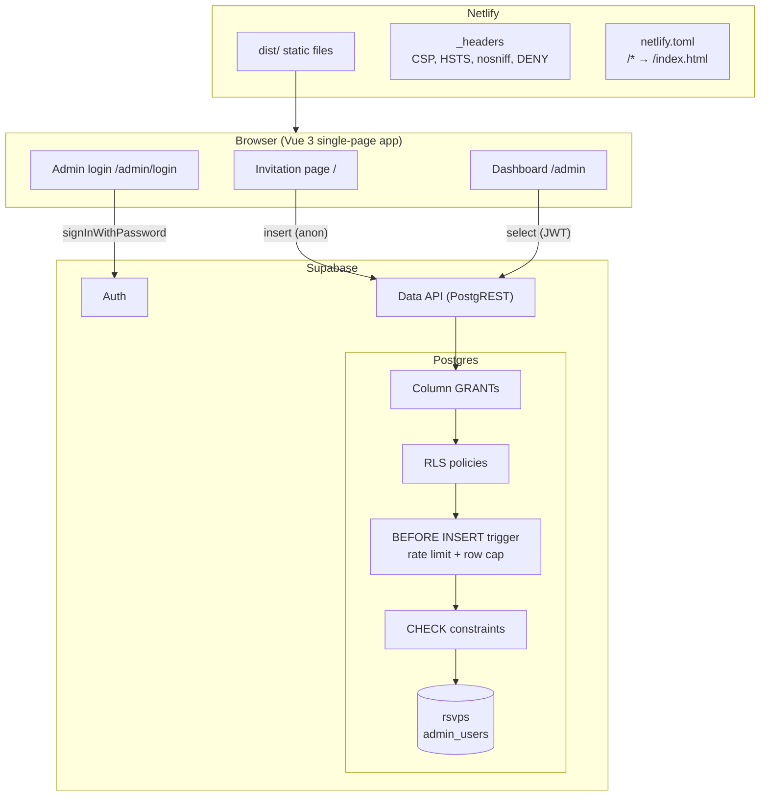
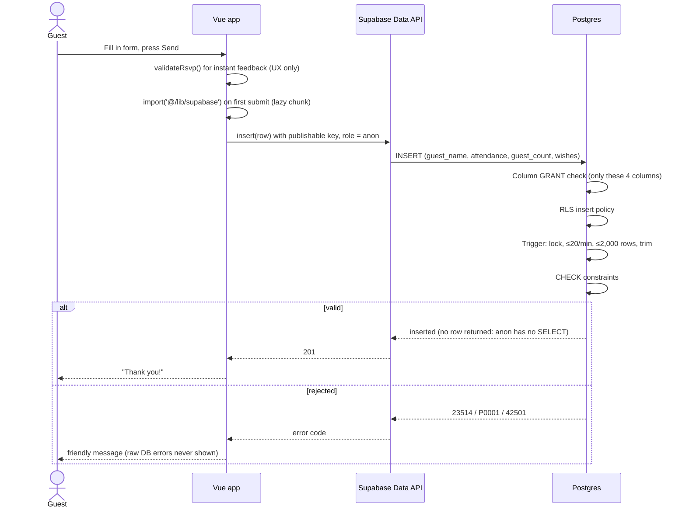
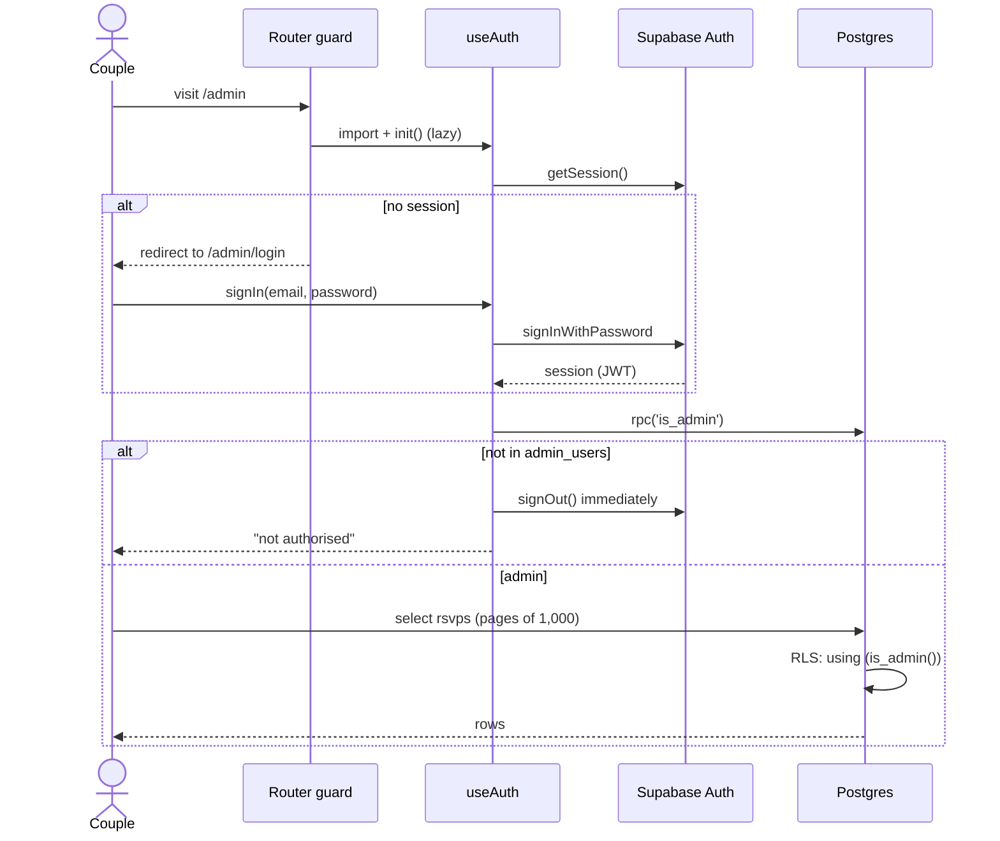
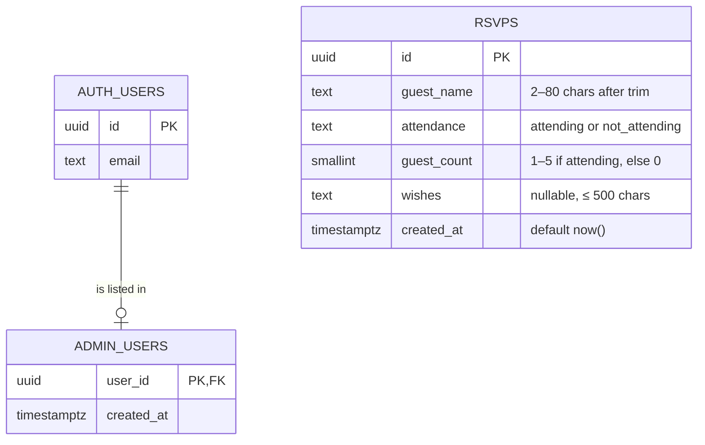
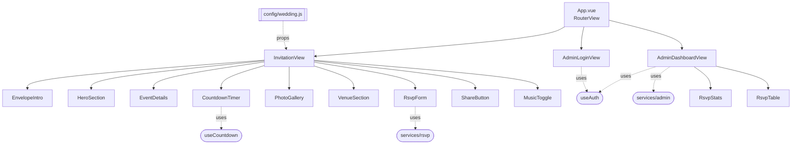

# Architecture

## 1. System overview

There is **no application server**. Netlify serves static files, and the browser calls Supabase directly.
All authorisation and validation that matters happens inside Postgres, so it applies to every client,
including someone calling the API with `curl`.

## 2. Request flows

### Guest submits an RSVP

### Couple opens the dashboard

If someone bypasses the guard in devtools, the last step still returns **zero rows**: the policy runs in the database.

## 3. Data model

`rsvps` is intentionally not linked to a user: guests don't sign in, and we store nothing that identifies them beyond the name they type.

| Role | `rsvps` | `admin_users` | `is_admin()` |
|---|---|---|---|
| `anon` (any visitor) | INSERT 4 columns | none | none |
| `authenticated`, not admin | SELECT allowed by grant, but RLS returns 0 rows | none | execute |
| `authenticated` admin | SELECT all rows | none (via API) | execute |
| Everyone via API | no UPDATE, no DELETE | none | |

## 4. Frontend structure

- **Views compose, components display.** Only `InvitationView` reads `config/wedding.js`; every section receives data through **props**.
  That keeps components testable with fake data, and means the data source can change (config → database) without touching them.
- **Composables hold reusable logic.** `useCountdown` gives each component its own timer. `useAuth` keeps
  **module-level** state, so the whole app shares one session (like Laravel's `Auth` facade).
- **Services wrap Supabase calls** and translate database errors into guest-friendly messages.
- **`utils/` are pure functions** (no Vue, no network): the easiest code to test.

## 5. Loading strategy

| Chunk | Loaded when | Size (gzip) |
|---|---|---|
| `index` (Vue, router, invitation) | Page load | ~41 KB + ~8 KB shared reactivity |
| `supabase` | First RSVP submit, or visiting `/admin` | ~55 KB |
| `AdminLoginView`, `AdminDashboardView`, `useAuth` | Visiting `/admin` | ~5 KB |
| Music file | Guest presses play (`preload="none"`) | file size |

Guests who only read the invitation never download Supabase or any admin code.
After a redeploy, old chunk names disappear. `main.js` detects a failed lazy load and reloads once.

## 6. Key decisions

| Decision | Alternatives considered | Why |
|---|---|---|
| Supabase direct from the browser, with RLS | Laravel or Node API | No server to run or pay for. Rules live next to the data and apply to every client. |
| Column-level `GRANT` + RLS + `CHECK` | RLS only | Defence in depth: grants stop forged columns, RLS controls rows, constraints validate content for every role. |
| `SECURITY DEFINER` trigger for rate limiting | Client-side throttling | Client code can be bypassed. The definer role is needed because `anon` can't count rows it can't see. |
| No `.select()` after insert | Return the inserted row | `anon` has no SELECT permission, by design. |
| Validation duplicated in JS | DB only | Instant feedback for guests; the DB remains the source of truth. |
| Paged dashboard fetch | Single `select()` | The API returns at most 1,000 rows by default; the DB allows 2,000. |
| Native `<dialog>` for the lightbox | Lightbox library | Escape, focus trap and backdrop for free; no dependency. |
| `public/_headers` read by both Netlify and `vite preview` | Headers only in Netlify | The exact production CSP is tested locally before deploying. |
| Content in `config/wedding.js` | Database table | Simplest for one wedding. Moves to the database in v2 (multi-couple). |
| Generated placeholder photos | Stock photos | No licensing questions; clearly labelled as placeholders. |
